  

<table>
<tr>
<td width="70%" valign="top">

Soy un **Desarrollador Full Stack** apasionado por crear aplicaciones **dinámicas, eficientes y fáciles de usar** — desde la interfaz hasta la base de datos.

Me enfoco en construir plataformas **completas y escalables**, con buena **arquitectura** y una gran **experiencia de usuario**.

Siempre estoy aprendiendo nuevas tecnologías y perfeccionando mis habilidades para crear soluciones digitales de **alto impacto**. 🚀

</td>
<td align="center" width="30%" valign="middle">

 
 
 

</td>
</tr>
</table>

<table>
<tr>
<td align="center" width="35%">

</td>
<td width="65%" valign="top">

**En lo que estoy trabajando ✦**

🌐 **Plataformas web completas y escalables**  
Construyendo aplicaciones de punta a punta con **Django**, **Next.js**, **React** y **TypeScript**.

🗄️ **Bases de datos relacionales**  
Diseño y optimización de bases de datos con **Prisma**, **PostgreSQL** y **MySQL**.

</td>
</tr>
</table>

<table>
<tr>
<td width="42%" valign="top">

**✦ tech stack**

**Frontend** 
 

**Backend & Base de datos** 
 
 

**Herramientas** 

</td>
<td width="58%" valign="top">

**✦ proyectos**

💼 **[Portafolio Web Personal](https://cesarbolivar.site/)**
Perfil profesional interactivo, bilingüe y con animaciones fluidas.
`React 19` `Vite` `TypeScript` `Tailwind CSS 4` `Framer Motion`

---

🔗 **[NetBio](https://netbio.site/)**
Enlaces centralizados, tarjetas vCard, códigos QR y captura de clientes potenciales.
`Next.js 16` `TypeScript` `Serverless Postgres` `Prisma` `Tailwind CSS 4`

</td>
</tr>
</table>

<h3 align="center"><code>// github stats</code></h3>

  

<h3 align="center"><code>// spent my time</code></h3>

  

 

  💙 gracias por pasar — construyamos algo juntos — <a href="mailto:cluisbolivarb@gmail.com">hablemos</a>

