  

  
  
  
  

  Creo aplicaciones <b>dinámicas, eficientes y fáciles de usar</b> — desde la interfaz hasta la base de datos. 
  Ahora mismo construyo plataformas web escalables con <b>Django</b>, <b>Next.js</b>, <b>React</b> y <b>TypeScript</b>, 
  y diseño bases de datos con <b>Prisma</b>, <b>PostgreSQL</b> y <b>MySQL</b>. 🚀

 

  

<table align="center">
<tr>
<td width="50%">

</td>
<td width="50%">

</td>
</tr>
</table>

  

  <b>FRONTEND</b> 
    
  <b>BACKEND & BASES DE DATOS</b> 
    
  <b>HERRAMIENTAS</b> 
  

  

  

  

  

  

